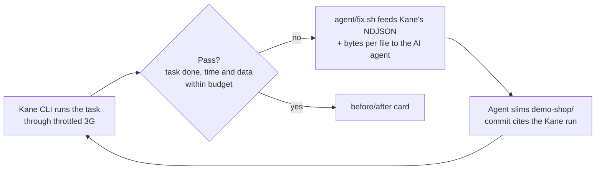

# LightLoad

**A heavy page costs ₦22 to load in Lagos. Kane proves it, an AI agent fixes it.**

A Kane CLI loop that makes websites usable on slow, expensive mobile data.

In Lagos, 1GB of mobile data costs about ₦1,000 and a lot of people browse on patchy 3G. A grocery page that ships 22MB of full-size photos, fonts and unused JavaScript costs the shopper ₦22 just to open the home page, and takes minutes to load. Lighthouse scores don't show that. LightLoad does: Kane CLI runs a real user task through a throttled connection and fails the page if the task is too slow or too heavy. An AI coding agent reads Kane's failure, slims the site, and Kane re-tests until it passes. No human edits in between.

## The loop



## Quickstart

```bash
npm install -g @testmuai/kane-cli && kane-cli login   # Kane CLI + credits
git init && git add -A && git commit -m "LightLoad baseline" && git tag heavy-baseline
./loop.sh                                             # test -> fix -> re-test, max 3 rounds
```

Needs Node 18+, Chrome, git, and one agent CLI: [Claude Code](https://claude.com/claude-code) (`claude`), Cursor (`cursor-agent`) or Codex (`codex`). Pick one with `LIGHTLOAD_AGENT=claude|cursor|codex`. Add `LIGHTLOAD_HEADED=1` to watch the browser (good for the video) and `LIGHTLOAD_NETWORK=2g` for the harsher preset.

| Command | What it does |
|---|---|
| `./lightload test` (or `./run.sh`) | Starts the shop on :3000 and the throttle on :8080, sets Kane to a 390x844 phone window, runs the task, writes `reports/run-N.*` |
| `./lightload fix` | Sends the latest failed Kane report to the agent and commits its fix |
| `./loop.sh` | Test, fix, re-test until Kane passes (max 3 fixes), then builds the card |
| `./lightload card [a] [b]` | `card/before-after.html` and `.png` for run a vs run b |
| `./lightload serve` / `stop` | Run the shop and throttle by hand |
| `./lightload reset` | Put `demo-shop/` back to the heavy baseline |

## How a run is judged

Kane gets this objective, against `http://localhost:8080` (the throttle):

> Search for rice, add it to cart and reach the checkout page. Fail if it takes longer than 30 seconds.

A run **passes** only if all three hold (`reports/run-N.json` → `checks`):

1. **Kane passed the task**: `run_end.status == "passed"` and exit code 0. Kane's `--timeout 300` turns a page that never finishes loading into a failure.
2. **Network wait ≤ 30s**: measured by the proxy as the time at least one request was in flight. This leaves out Kane's own thinking time, so the number is about the page, not the test agent.
3. **Data ≤ 1MB**: every byte the proxy sent to the browser, headers included.

Cost = MB used × ₦1,000/GB. All budgets and network presets live in `lightload.config.json`.

| Preset | Down | Latency |
|---|---|---|
| `3g` (default) | 400 kbps | 400 ms per request |
| `2g` | 150 kbps | 800 ms per request |

## What's in the repo

- `demo-shop/`: FreshMart Lagos, a static grocery shop (home, search, product, cart, checkout), made heavy on purpose: real Wikimedia Commons food photos served at full size (3.4 to 4MB heroes, 1.5 to 4.5MB product photos shown at card size), unused lodash + moment (1.2MB) loaded render-blocking in `<head>`, 2MB of TTF web fonts, no lazy loading.
- `proxy/throttle.js`: Node proxy with one shared downstream pipe (like one phone connection), per-request latency, per-file byte counts. `GET /__lightload/stats`, `POST /__lightload/reset`.
- `proxy/serve-shop.js`: static server. Serves `file.br`/`file.gz` when present and accepted, and long-cache headers under `/static/`, so the agent has real levers.
- `agent/fix.sh` + `agent/build-prompt.js`: builds the prompt from `run-N.json`, the last 40 lines of Kane's NDJSON, the per-file byte table and the file tree, then runs the agent CLI with it. No copy-paste.
- `reports/`: proof. `run-N.ndjson` (Kane's raw stream), `run-N.bytes.json` (proxy), `run-N.json` (verdict).
- `agent/log.md`, `agent/prompts/`, `agent/transcripts/`: what the agent was told and what it did.
- `card/`: the before/after card.

### Guardrails, so the agent can't cheat

- Edits outside `demo-shop/` are reverted after every fix (proxy, budgets, scripts are off limits).
- The run's evidence is copied aside before the agent starts and restored after, so reports can't be rewritten.
- The agent never commits. `fix.sh` makes one commit per fix that names the Kane run, e.g. `fix: right-sized webp photos, drop unused lodash/moment/fonts, defer js, gzip (Kane run #1 failed: 152.47s, 2.26MB, ₦2.21)`.
- The next Kane run checks the task still works. A fix that breaks search or checkout fails.

## Results (real Kane CLI runs, 26 Nov 2026)

Same task, same throttle (3G preset: 400 kbps down, 400 ms latency), Kane CLI 0.10.9 in Chrome at 390x844. The shop uses real food photos from Wikimedia Commons ([credits](demo-shop/img/CREDITS.md)).

| | Before (run #1, tag `heavy-baseline`) | After (run #2, one agent fix) |
|---|---|---|
| Kane verdict | **FAIL** (exit 3) | **PASS** (exit 0) |
| What Kane saw | Stuck on the home page: render-blocking lodash + moment and 2 MB of TTF fonts held the page, Kane's first screenshot "waited 60 seconds for fonts" and timed out. No shopping step ran. | Searched rice, added to cart, went to cart, reached checkout |
| Kane run time | 145s | 62.9s |
| Network wait (proxy) | 152.47s (budget 30s) | 10.53s |
| Data sent to the phone | 2.26 MB before Kane gave up (budget 1 MB). The full heavy home page is ~22.5 MB (multi-MB original photos). | 0.29 MB for the whole task |
| Cost per visit (₦1,000/GB) | ₦2.21, and still no checkout | ₦0.29 |
| Per 1,000 visits | ₦2,206 | ₦286 |

**93% less waiting, 87% less data**, and the shopper actually reaches checkout. The fix keeps the same design and the same photos, just right-sized WebP versions of them.


### Evidence

| What | Where |
|---|---|
| Kane's raw NDJSON stream, failed run | [`reports/run-1.ndjson`](reports/run-1.ndjson) |
| Verdict + numbers, failed run | [`reports/run-1.json`](reports/run-1.json), bytes per file: [`reports/run-1.bytes.json`](reports/run-1.bytes.json) |
| Prompt the agent got, built automatically from run #1 | [`agent/prompts/run-1.md`](agent/prompts/run-1.md) |
| Agent handoff transcript | [`agent/transcripts/run-1.txt`](agent/transcripts/run-1.txt) |
| Fix log | [`agent/log.md`](agent/log.md) |
| Fix commit citing the Kane run | `fix: right-sized webp photos, drop unused lodash/moment/fonts, defer js, gzip (Kane run #1 failed: 152.47s, 2.26MB, ₦2.21)` |
| Kane's raw NDJSON stream, passing run | [`reports/run-2.ndjson`](reports/run-2.ndjson), verdict [`reports/run-2.json`](reports/run-2.json) |
| Before/after card | [`card/before-after.png`](card/before-after.png), [`card/before-after.html`](card/before-after.html) |
| Heavy version of the shop | git tag `heavy-baseline` |
| First loop on the earlier placeholder-image shop (history) | [`reports/archive-placeholder-photos/`](reports/archive-placeholder-photos/) |

**Agent used:** Grok Bot, an AI agent, through `LIGHTLOAD_AGENT=custom LIGHTLOAD_AGENT_CMD="bash agent/handoff.sh"`. `agent/fix.sh` built the prompt from Kane's report and handed it to the agent automatically; the agent edited only `demo-shop/`, and `fix.sh` made the commit. The same step runs with Claude Code, Cursor (`cursor-agent`) or Codex by setting `LIGHTLOAD_AGENT`.

### Live demo

Before vs after, side by side: https://hauwarh.github.io/LightLoad/ ([before](https://hauwarh.github.io/LightLoad/before/index.html), [after](https://hauwarh.github.io/LightLoad/after/index.html))

> **Note for judges:** both pages look the same on fast Wi-Fi, because the design is identical; only the weight differs. To feel the difference, open them on slow mobile data, or in Chrome DevTools > Network > "Slow 3G". The before home page is ~22.5 MB; the after shop is ~0.3 MB for the whole task.

Demo video: link coming soon (YouTube).

## Self-test (no Kane credits needed)

`bash test/selftest.sh` runs the whole loop in a temp copy with a **stand-in** for Kane (`test/fake-kane.js`, which fetches the task path through the proxy and prints Kane-shaped NDJSON) and a scripted fixer (`test/scripted-agent.py`). It checks the plumbing only. The real proof is `./loop.sh` with Kane CLI and a real agent.

## License

MIT for LightLoad's code. `demo-shop/vendor/` (lodash, moment, MIT) and `demo-shop/fonts/` (DejaVu, free license) keep their own licenses.
