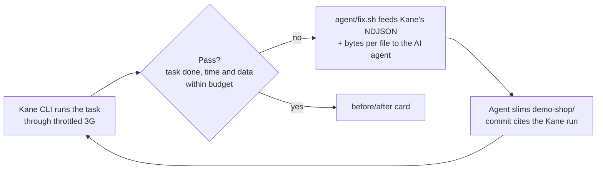
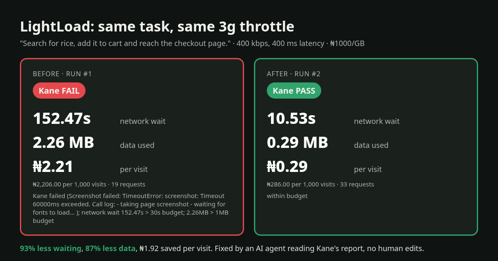

# LightLoad

**Your page costs ₦20 to load in Lagos. Kane proves it, an AI agent fixes it.**

A Kane CLI loop that makes websites usable on slow, expensive mobile data.

In Lagos, 1GB of mobile data costs about ₦1,000 and a lot of people browse on patchy 3G. A grocery page that ships 20MB of images, fonts and unused JavaScript costs the shopper ₦20 just to reach checkout, and takes minutes to load. Lighthouse scores don't show that. LightLoad does: Kane CLI runs a real user task through a throttled connection and fails the page if the task is too slow or too heavy. An AI coding agent reads Kane's failure, slims the site, and Kane re-tests until it passes. No human edits in between.

## The loop



## Quickstart

```bash
npm install -g @testmuai/kane-cli && kane-cli login   # Kane CLI + credits
git init && git add -A && git commit -m "LightLoad baseline" && git tag heavy-baseline
./loop.sh                                             # test -> fix -> re-test, max 3 rounds
```

Needs Node 18+, Chrome, git, and one agent CLI: [Claude Code](https://claude.com/claude-code) (`claude`), Cursor (`cursor-agent`) or Codex (`codex`). Pick one with `LIGHTLOAD_AGENT=claude|cursor|codex`. Add `LIGHTLOAD_HEADED=1` to watch the browser (good for the video) and `LIGHTLOAD_NETWORK=2g` for the harsher preset.

| Command | What it does |
|---|---|
| `./lightload test` (or `./run.sh`) | Starts the shop on :3000 and the throttle on :8080, sets Kane to a 390x844 phone window, runs the task, writes `reports/run-N.*` |
| `./lightload fix` | Sends the latest failed Kane report to the agent and commits its fix |
| `./loop.sh` | Test, fix, re-test until Kane passes (max 3 fixes), then builds the card |
| `./lightload card [a] [b]` | `card/before-after.html` and `.png` for run a vs run b |
| `./lightload serve` / `stop` | Run the shop and throttle by hand |
| `./lightload reset` | Put `demo-shop/` back to the heavy baseline |

## How a run is judged

Kane gets this objective, against `http://localhost:8080` (the throttle):

> Search for rice, add it to cart and reach the checkout page. Fail if it takes longer than 30 seconds.

A run **passes** only if all three hold (`reports/run-N.json` → `checks`):

1. **Kane passed the task**: `run_end.status == "passed"` and exit code 0. Kane's `--timeout 300` turns a page that never finishes loading into a failure.
2. **Network wait ≤ 30s**: measured by the proxy as the time at least one request was in flight. This leaves out Kane's own thinking time, so the number is about the page, not the test agent.
3. **Data ≤ 1MB**: every byte the proxy sent to the browser, headers included.

Cost = MB used × ₦1,000/GB. All budgets and network presets live in `lightload.config.json`.

| Preset | Down | Latency |
|---|---|---|
| `3g` (default) | 400 kbps | 400 ms per request |
| `2g` | 150 kbps | 800 ms per request |

## What's in the repo

- `demo-shop/`: FreshMart Lagos, a static grocery shop (home, search, product, cart, checkout), made heavy on purpose: 3.5 to 4MB hero JPEGs, 1MB product photos shown at thumbnail size, unused lodash + moment (1.2MB) loaded render-blocking in `<head>`, 2MB of TTF web fonts, no lazy loading.
- `proxy/throttle.js`: Node proxy with one shared downstream pipe (like one phone connection), per-request latency, per-file byte counts. `GET /__lightload/stats`, `POST /__lightload/reset`.
- `proxy/serve-shop.js`: static server. Serves `file.br`/`file.gz` when present and accepted, and long-cache headers under `/static/`, so the agent has real levers.
- `agent/fix.sh` + `agent/build-prompt.js`: builds the prompt from `run-N.json`, the last 40 lines of Kane's NDJSON, the per-file byte table and the file tree, then runs the agent CLI with it. No copy-paste.
- `reports/`: proof. `run-N.ndjson` (Kane's raw stream), `run-N.bytes.json` (proxy), `run-N.json` (verdict).
- `agent/log.md`, `agent/prompts/`, `agent/transcripts/`: what the agent was told and what it did.
- `card/`: the before/after card.

### Guardrails, so the agent can't cheat

- Edits outside `demo-shop/` are reverted after every fix (proxy, budgets, scripts are off limits).
- The run's evidence is copied aside before the agent starts and restored after, so reports can't be rewritten.
- The agent never commits. `fix.sh` makes one commit per fix that names the Kane run, e.g. `fix: webp images, drop unused lodash/moment (Kane run #1 failed: 300s, 20.6MB, ₦20.13)`.
- The next Kane run checks the task still works. A fix that breaks search or checkout fails.

## Results

<!-- Fill in from card/before-after.png after your real Kane run. -->

| | Before (run #1) | After (run #N) |
|---|---|---|
| Kane | FAIL | PASS |
| Network wait (3G) | _s | _s |
| Data used | _ MB | _ MB |
| Cost per visit | ₦_ | ₦_ |



Demo video: _link_

## Self-test (no Kane credits needed)

`bash test/selftest.sh` runs the whole loop in a temp copy with a **stand-in** for Kane (`test/fake-kane.js`, which fetches the task path through the proxy and prints Kane-shaped NDJSON) and a scripted fixer (`test/scripted-agent.py`). It checks the plumbing only. The real proof is `./loop.sh` with Kane CLI and a real agent.

## License

MIT for LightLoad's code. `demo-shop/vendor/` (lodash, moment, MIT) and `demo-shop/fonts/` (DejaVu, free license) keep their own licenses.
